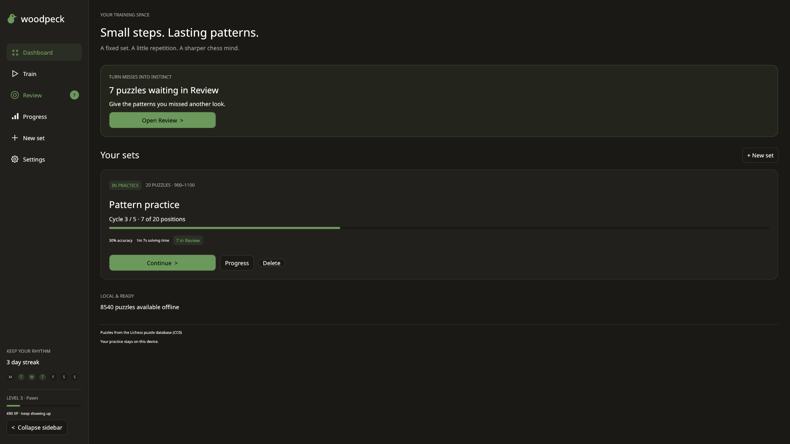
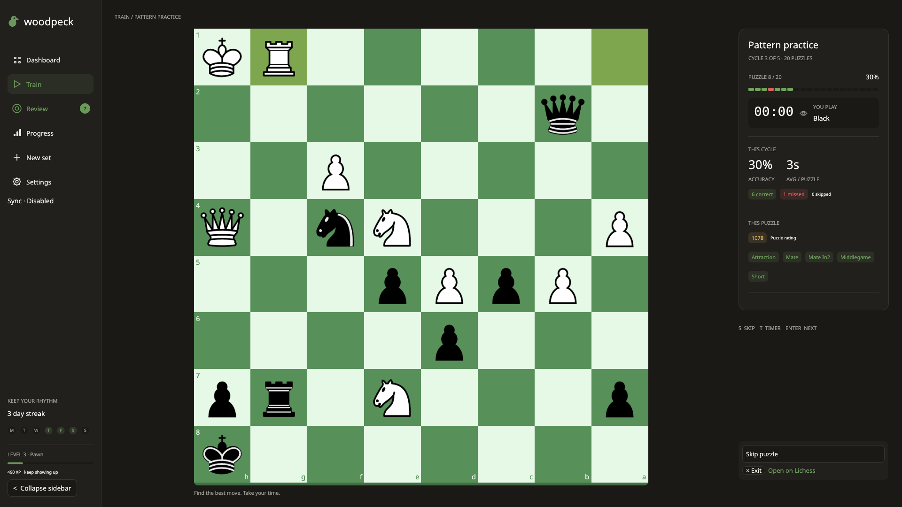
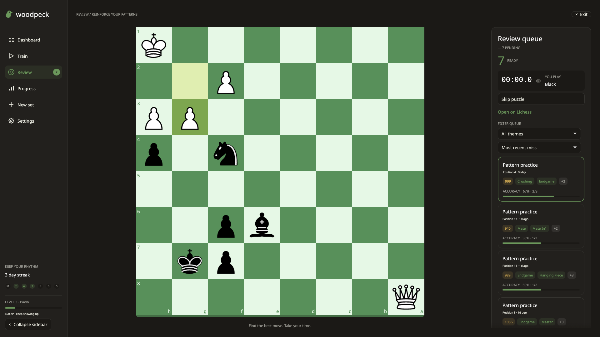
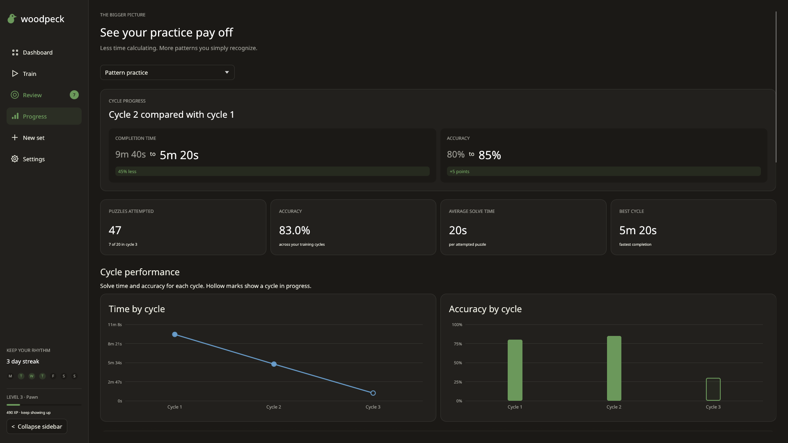
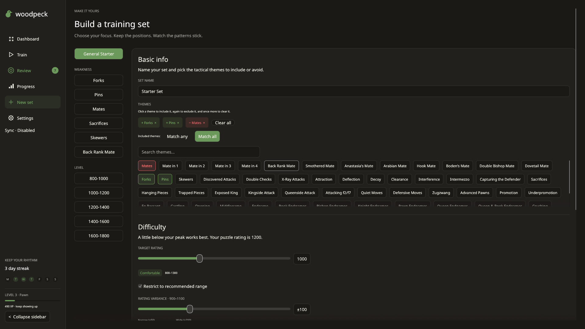
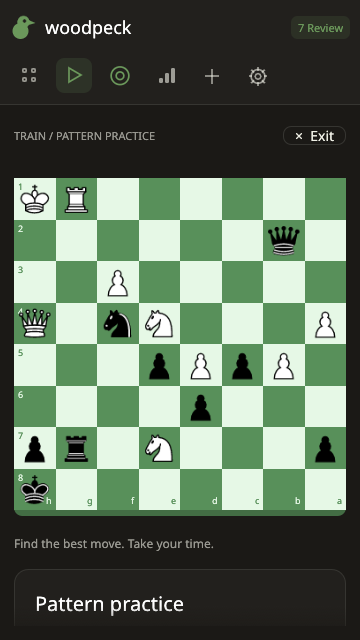
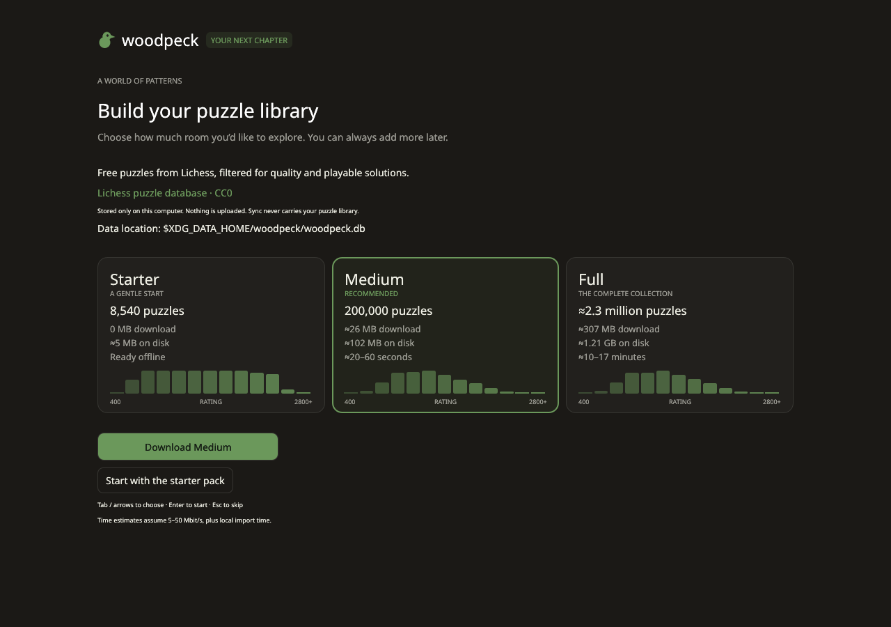
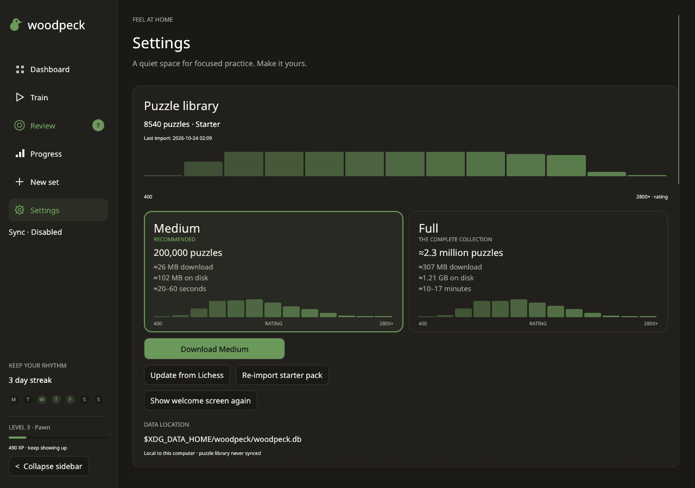

# woodpeck

A native **Woodpecker Method chess puzzle trainer**, inspired by [Peck Chess](https://peckchess.com). Build a fixed set of positions, repeat it over several cycles, and watch your solving time and accuracy improve. No login; your sets, results, and settings stay in a local SQLite database.

## Features

- **A review queue that catches every miss.** Wrong answers and skips enter Review immediately, with a pending badge in navigation and a dashboard callout. Filter by theme or sort by recency and accuracy. Only a correct solve in Review clears an item; review attempts update lifetime accuracy without changing cycle results. The puzzle stays in its set for future cycles.
- **Sets and presets.** General, tactical weakness, and rating presets; multi-theme filters that include and exclude Lichess themes; 20–500 positions; an inclusive rating range (400–3200, at least 100 points wide) set with a two-handle slider, number fields or quick ranges around your rating; and 1–10 cycles. Fixed snapshots preserve your positions when the puzzle library changes. Optional seeded shuffling changes the order each cycle.
- **Cycles and a count-up timer.** Resume across restarts, compare cycles, and step through the solution after a mistake. The timer pauses during animations, feedback, walkthroughs, promotion, and loss of focus. Optional completion sound and auto-advance.
- **Progress.** Time and accuracy charts, comparisons with cycle one, performance by theme, and most-missed positions. Small local streak, XP, and rank widgets.
- **Omarchy theme sync with live reload.** Desktop colors and fontconfig fonts, with two-second theme polling that follows directory and symlink swaps. Built-in dark and light themes and eight board palettes.
- **Responsive tiling layout.** Native Wayland and X11, a sidebar that collapses into a rail or top bar, and a board/panel layout that stacks below 900 px. Supports narrow 360 px tiles, wide displays, and HiDPI. SVG pieces, click/click and drag/drop, legal targets, and promotion selection.
- **A library that grows with you.** First-run onboarding offers the offline 8,540-puzzle Starter pack, a recommended 200,000-puzzle Medium library, or the complete filtered Lichess database. Watch live rating distributions as puzzles arrive, cancel while retaining committed batches, or continue training in the background. Manage and update the library in Settings. If a requested set has too few local matches, the builder offers a Lichess API fallback. Export your sets as PGN from Settings.

Puzzles from the Lichess puzzle database (CC0).

## Screenshots

Screenshots use an isolated demo database, with real training and review state. Welcome captures also include deterministic [download progress](docs/screenshots/welcome-progress.png) and [completion](docs/screenshots/welcome-done.png).

| Dashboard | Training |
| --- | --- |
|  |  |
| Review queue | Progress |
|  |  |
| Set builder | Narrow training, 360×640 |
|  |  |
| Welcome | Puzzle library |
|  |  |

## Build and install

Requires Rust **1.97 or newer** (edition 2024). `rust-toolchain.toml` selects stable with rustfmt and Clippy. SQLite is bundled and HTTPS uses rustls.

Arch / Omarchy:

```sh
sudo pacman -S --needed rust wayland libxkbcommon alsa-lib fontconfig
```

Debian / Ubuntu:

```sh
sudo apt-get update
sudo apt-get install --no-install-recommends -y \
  build-essential pkg-config libxkbcommon-dev libwayland-dev libx11-dev \
  libxcursor-dev libxrandr-dev libxi-dev libgl1-mesa-dev libegl1-mesa-dev \
  libasound2-dev libfontconfig1-dev
```

Build from source:

```sh
git clone https://github.com/heroesofcode/woodpeck.git
cd woodpeck
cargo build --release --locked
./target/release/woodpeck
```

Install the binary, desktop entry, and icon for your user:

```sh
install -Dm755 target/release/woodpeck "$HOME/.local/bin/woodpeck"
install -Dm644 assets/woodpeck.desktop "$HOME/.local/share/applications/woodpeck.desktop"
install -Dm644 assets/woodpeck.svg "$HOME/.local/share/icons/hicolor/scalable/apps/woodpeck.svg"
```

Ensure `$HOME/.local/bin` is in your `PATH`. The starter pack and chess pieces are embedded in the binary, so no asset directory is needed at runtime.

Prebuilt x86_64 Linux tarballs are attached to each [GitHub release](https://github.com/heroesofcode/woodpeck/releases), with a SHA-256 checksum and a build provenance attestation (`gh attestation verify <tarball> --repo heroesofcode/woodpeck`). Extract one and run the same `install` commands from inside it, using `woodpeck`, `woodpeck.desktop`, and `woodpeck.svg` from the top level.

The default `sound` feature uses ALSA on Linux; playback happens in the background and quietly skips unavailable audio devices. To omit audio, build with `cargo build --release --locked --no-default-features`.

## Usage

On first launch, choose a puzzle library or select **Start with the starter pack** to train offline immediately. The welcome screen explains the local data location and Lichess CC0 source. Existing installations with more than 9,540 puzzles skip this introduction automatically. The choice and library metadata belong to this computer and are never synced.

Start with **New set**, choose a preset, optionally adjust the themes, then create a set. **Continue** resumes its current cycle. After a wrong move, walk through the missed line or advance; the item is already in **Review**. Use Review regularly and solve each queued puzzle correctly to clear it. **Progress** compares completed cycles. **Settings** controls themes, auto-advance, sound, tactical labels, imports, and PGN export.

### Choosing themes

The builder's **Themes** picker lists Lichess puzzle themes; type in the search box to narrow it. Click a theme once to **include** it (green), again to **exclude** it (red, struck through), and a third time to clear it. Selected themes appear as chips above the search box; click a chip to remove it, or **Clear all**.

- No included themes: any theme qualifies.
- With two or more included themes, choose **Match any** (a puzzle needs at least one) or **Match all** (it needs every one).
- Excluded themes always win: a puzzle with any excluded theme is never picked.

Weakness presets start with their theme included, and you can add more from there. If the local library and the Lichess fallback can't fill the set, woodpeck creates nothing and tells you how many matching puzzles it found. It never saves a partial set. The fallback asks Lichess for one included theme at a time, rotating through them, and applies the full filter locally. Dashboard cards show each set's themes.

| Key | Action |
| --- | --- |
| `S` | Skip on the player's turn; add to Review |
| `T` | Toggle timer visibility |
| `←` | Previous move in the missed-line walkthrough |
| `→` / `Space` | Next move in the walkthrough |
| `Enter` / `Space` | Next puzzle after completion |

Shortcuts pause while typing, while a menu/dialog or promotion picker is open, or while modifiers are held. Promote using the on-screen Q/R/B/N picker.

### Import puzzles

```sh
woodpeck import /path/to/lichess_db_puzzle.csv.zst
woodpeck import /path/to/puzzles.csv
woodpeck import https://database.lichess.org/lichess_db_puzzle.csv.zst
woodpeck import --lichess                    # default: full database
woodpeck import --lichess --size medium      # stop at 200,000 accepted puzzles
woodpeck import --lichess --size full
woodpeck import /path/to/puzzles.csv.zst --limit 10000
woodpeck import /path/to/puzzles.csv.zst --size medium --limit 50000
woodpeck --help
```

| Library | Puzzles | Download | Database on disk | Estimated time |
| --- | ---: | ---: | ---: | --- |
| Starter | 8,540 | 0 MB | ≈5 MB | Ready offline |
| Medium (recommended) | 200,000 | ≈26 MB | ≈102 MB | ≈20–60 seconds |
| Full | ≈2.3 million | ≈307 MB | ≈1.21 GB | ≈10–17 minutes |

Measurements use the 2026-10-22 Lichess dump and a release build. Medium consumed
26,354,267 compressed bytes, scanned 527,077 rows and took 15.03 seconds locally.
Full consumed 307,234,795 bytes, scanned 6,157,341 rows and accepted 2,335,803 puzzles;
local wall time was 524.61 seconds, including SQLite's final checkpoint/close.
Database sizes after close were 101,732,352 and 1,208,946,688 bytes respectively.
The displayed time ranges add transfer time at 5–50 Mbit/s to measured local time;
actual performance depends on the computer, connection and existing library.
Disk figures describe a fresh library; imports and saved sets can need more space.

**Settings → Puzzle library** shows the count, recorded size, local last-import date,
and rating histogram. Download Medium or Full, update the recorded size from Lichess,
re-import Starter, cancel an active download, or show the welcome screen again.
The download can keep running while you use the app, with a small status in navigation.
For older libraries without size markers, committed counts above 9,540 imply Medium;
counts of at least 1,000,000 imply Full. Smaller imports never downgrade the recorded
size or label a larger store as Starter. Updating Starter or an unknown size from
Lichess downloads Full; the starter pack has its own re-import action. Downloads can
queue behind startup preparation, whose progress and cancellation appear in Settings.
Cancelling keeps committed
puzzles and leaves the previous size/date markers unchanged.

The Settings download buttons use the same streaming importer. Imports accept plain or zstd-compressed Lichess CSV, filter for popularity ≥80, rating deviation ≤100, ≥500 plays, and exclude `veryLong` puzzles. Invalid chess lines are rejected. Progress reports compressed bytes, scanned/accepted/rejected rows, and a live rating histogram. `--size` defaults to `full`; `--limit N` accepts a positive puzzle count for any local path or URL and overrides the preset limit. Rejected rows do not count. Medium stops reading as soon as 200,000 accepted rows have been saved, closing the stream early. Each CLI import prints a final count, byte, disk-size and wall-time summary. Cancelling in Settings retains committed batches of 1,000 accepted rows and drops the unfinished batch.

The API fallback is offered explicitly when local generation is short; it makes sequential requests and waits at least 60 seconds after HTTP 429. Requests use the Lichess difficulty levels that overlap your range, and the results are filtered locally to the exact range. The range is never widened silently. If too few puzzles match, the builder shows the shortfall so you can widen the range, change the themes, or fetch more. An incomplete set is never saved.

### Desktop integration and local data

The window title, X11 class, and Wayland app ID are `woodpeck`. An optional Hyprland rule for configurations using the classic rule syntax:

```ini
windowrule = float, class:^(woodpeck)$
```

Keep normal tiling to use the responsive layout. Rule syntax depends on your Hyprland version.

| Data | Linux location |
| --- | --- |
| Database, sets, attempts, review queue, settings | `$XDG_DATA_HOME/woodpeck/woodpeck.db` |
| Default database when XDG is unset | `$HOME/.local/share/woodpeck/woodpeck.db` |
| Optional database directory override | `$WOODPECK_DATA_DIR/woodpeck.db` |
| Current Omarchy theme | `$HOME/.local/state/omarchy/current/theme/` |
| Legacy Omarchy theme fallback | `$HOME/.config/omarchy/current/theme/` |

Settings are stored in SQLite. Theme discovery reads `colors.toml`, falls back to legacy `alacritty.toml`, and supports Omarchy's color aliases and mode detection. System follows Omarchy when available and otherwise uses the built-in dark palette. Choose Light or Dark to override it.

## Sync across computers

Sync is opt-in. Use a **PRIVATE repository you own**: the repository contains
training history, review mistakes, preferences, and the complete puzzles in
your sets. Anyone with repository access can read that history. Git sync is not
end-to-end encryption. The full puzzle library, local paths, window settings,
audio devices, and sync credentials/configuration are not synced.

With the GitHub CLI installed and authenticated, create or reuse your private
`woodpeck-data` repository:

```sh
gh auth login
gh auth setup-git
woodpeck sync init --create
```

Alternatively, create an empty private repository manually and initialize it:

```sh
woodpeck sync init 'https://github.com/<user>/woodpeck-data.git'
# Or use your configured SSH key:
woodpeck sync init 'git@github.com:<user>/woodpeck-data.git'
```

Run the same `sync init <remote-url>` on each computer. Imported sets include
all positions and solutions, so they work without downloading the Lichess
library. Sync includes sets, cycles, every attempt, review state, preferences,
and reconstructed XP/streaks. Git must be on PATH. Authentication uses your
system Git credential helpers (`gh auth setup-git` for GitHub HTTPS), or SSH.
woodpeck never stores tokens; do not put credentials in the remote URL. Commits
use the fixed identity `woodpeck <woodpeck@localhost>` inside the data repository.
Your global Git identity and source checkout are unchanged.

Use Settings → Sync to edit the URL, enable/disable sync, sync now, and inspect
the last sync and error. The navigation indicator reports pending, syncing,
synced, offline, conflict resolved, or error. CLI equivalents:

```sh
woodpeck sync now
woodpeck sync status
woodpeck sync disable
```

Enabled startup pulls in the background. Changes sync after a 10-second pause;
closing the app makes a bounded best-effort attempt. Offline training continues
normally, with pending changes retried automatically and on next startup. A
manual sync reports connection or authentication errors instead of prompting
for a password.

Two computers' progress is merged semantically: attempts are retained by UID,
metadata and preferences use timestamps per field, and review items clear only
when a correct review solve is later than their latest miss. Keep system clocks
accurate. Equal-time review conflicts remain pending. Git text conflicts need
no manual editing. Sets are merged as a union: deleting a local set can restore
it from remote history on the next sync. A newer remote format stops sync until
you upgrade; for example, multi-theme sets use format 2, which older releases refuse rather than misread. Current releases upgrade format 1 data automatically. Disabling leaves local progress and existing private Git history
in place; it does not delete the remote repository.

Local sync files live in `$XDG_DATA_HOME/woodpeck/sync/` (or the platform data
directory / `$WOODPECK_DATA_DIR` override), beside SQLite. Keep this directory
outside the woodpeck source tree. See [the versioned format](docs/sync-format.md)
for the portable schema and merge rules.

## Development

```sh
export CARGO_BUILD_JOBS=4
cargo fmt --all --check
cargo clippy --all-targets --all-features --locked -- -D warnings
cargo clippy --all-targets --no-default-features --locked -- -D warnings
cargo test --all-features --locked
cargo test --no-default-features --locked
cargo build --release --locked
cargo install cargo-deny --locked
cargo deny check
```

Clippy pedantic is enabled; unsafe code is forbidden. Tests use fixtures, isolated SQLite databases, and loopback HTTP servers. The CI aggregate check is named `ci` and requires formatting, both Clippy configurations, tests, the release build, benchmark compilation, and supply-chain checks to succeed. PR titles use Conventional Commits.

**Benchmarks:** Run `cargo bench --locked` for move validation, in-memory store operations,
set generation, piece rasterization, and headless training frames (including dragging and
completion and advancement). Set `WOODPECK_BENCH_DB` to a closed database file to also
benchmark disk-backed completion, feedback, advancement, and maximum frame time over a
solve-and-advance sequence. Each run opens a disposable copy in the system temporary
directory and creates training sets there as needed; the source is only copied.
`WOODPECK_FRAME_STATS=1 cargo run --release --locked` prints application
logic and UI CPU p50/p95/max times to stderr every five seconds of activity. It also works
under Xvfb. These timings exclude GPU presentation; the headless benchmarks include tessellation.

Generate a screenshot without opening your real database (requires Xvfb and `xauth`; on Debian/Ubuntu install `xvfb xauth`):

```sh
xvfb-run -a -s '-screen 0 1920x1080x24' \
  target/release/woodpeck --screenshot /tmp/training.png --screen training --size 1920x1080
```

Validate every screen at common tiling sizes:

```sh
mkdir -p /tmp/woodpeck-screenshots
for screen in dashboard training review progress builder settings welcome welcome-progress welcome-done; do
  for size in 360x640 960x1080 1920x1080; do
    xvfb-run -a -s '-screen 0 1920x1080x24' \
      target/release/woodpeck --screenshot "/tmp/woodpeck-screenshots/$screen-$size.png" \
      --screen "$screen" --size "$size"
  done
done
```

The three welcome screenshot screens use deterministic offline demo data, with animations settled for the capture.

The code separates the puzzle engine, injected timer, set generation, review rules, progress calculations, streaming sources, SQLite repositories, and background application service from the native UI in `src/app/`.

## Credits and licenses

- Inspired by [Peck Chess](https://peckchess.com) and the Woodpecker Method.
- Puzzles from the [Lichess puzzle database](https://database.lichess.org/#puzzles), released under [CC0](https://creativecommons.org/publicdomain/zero/1.0/). This includes the bundled starter pack.
- **cburnett chess pieces** by Colin M.L. Burnett, from [lichess-org/lila](https://github.com/lichess-org/lila/tree/master/public/piece/cburnett), dual licensed **GPLv2+ / CC BY-SA 3.0**. See [assets/pieces/LICENSE](assets/pieces/LICENSE). Pieces are rasterized locally with resvg.
- Built with Rust, eframe/egui, shakmaty, pgn-reader, rusqlite, and other open-source libraries listed in `Cargo.toml` and `Cargo.lock`.
- woodpeck is licensed under **GPL-3.0-or-later**. See [LICENSE](LICENSE).
